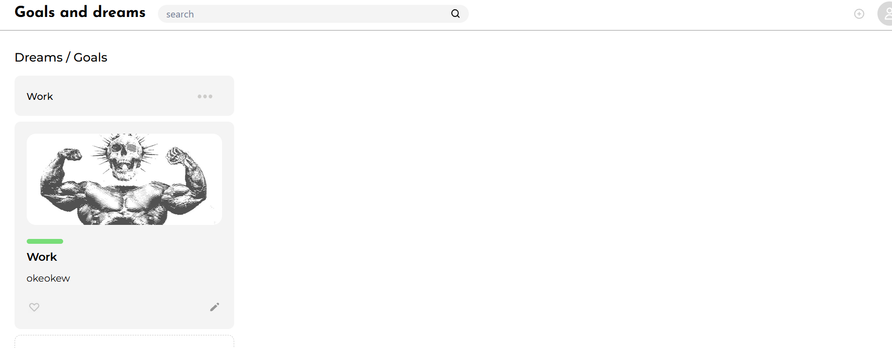

# 🎯 Goals & Dreams — Приложение для управления целями и задачами

**Goals & Dreams** — мой личный pet-проект, представляющий собой веб-приложение для планирования, записи и отслеживания личных целей и повседневных задач.

Приложение помогает пользователям структурировать свои планы, фиксировать идеи, ставить перед собой цели и следить за их выполнением. Основной акцент сделан на удобстве использования, простоте управления задачами и сохранении пользовательских данных.

Для управления состоянием приложения используется **Zustand**, а для хранения данных — **LocalStorage**, благодаря чему информация сохраняется в браузере даже после перезагрузки страницы.


## 📸 Скриншот проекта



## ✨ Основные возможности

- **Управление целями** — создание и запись личных целей.
- **Управление задачами** — добавление, редактирование и удаление задач.
- **Отслеживание прогресса** — контроль выполнения поставленных задач.
- **Управление состоянием** — централизованное хранение данных с помощью Zustand.
- **Локальное хранение данных** — сохранение информации в LocalStorage.
- **Сохранение изменений** — данные остаются доступными после перезагрузки страницы.
- **Удобный интерфейс** — простой и понятный пользовательский интерфейс для повседневного планирования.

## 🛠️ Используемые технологии

- **React 18** — разработка пользовательского интерфейса.
- **JavaScript (ES6+)** — реализация логики приложения.
- **Zustand** — управление глобальным состоянием приложения.
- **LocalStorage** — локальное хранение пользовательских данных.
- **React Router DOM** — маршрутизация между страницами.
- **Chakra UI** — готовые компоненты пользовательского интерфейса.
- **Emotion** — стилизация компонентов.
- **Styled Components** — создание стилизованных компонентов.
- **Framer Motion** — реализация анимаций и интерактивных переходов.
- **Nanoid** — генерация уникальных идентификаторов.

## ⚙️ Установка и запуск

1. Клонировать репозиторий:

   ```bash
   git clone YOUR_REPOSITORY_LINK
   ```

2. Перейти в папку проекта:

   ```bash
   cd goals-and-dreams
   ```

3. Установить зависимости:

   ```bash
   npm install
   ```

4. Запустить проект:

   ```bash
   npm start
   ```

## 🎯 Цель проекта

Проект разработан в рамках самостоятельной практики (Pet Project) для закрепления навыков разработки на React, изучения управления глобальным состоянием приложения с помощью Zustand и работы с браузерным хранилищем LocalStorage.

В ходе разработки были получены практические навыки построения компонентной архитектуры, организации состояния приложения, сохранения пользовательских данных, создания интерактивных интерфейсов и реализации анимаций с помощью Framer Motion.
